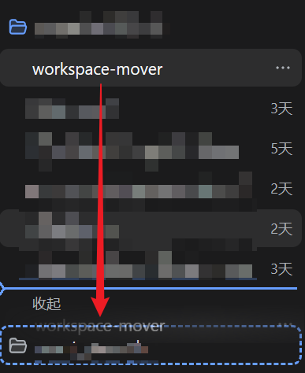
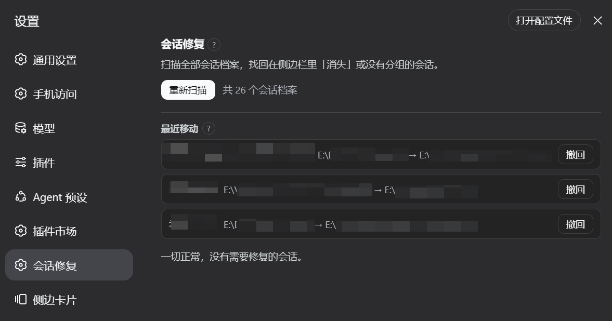
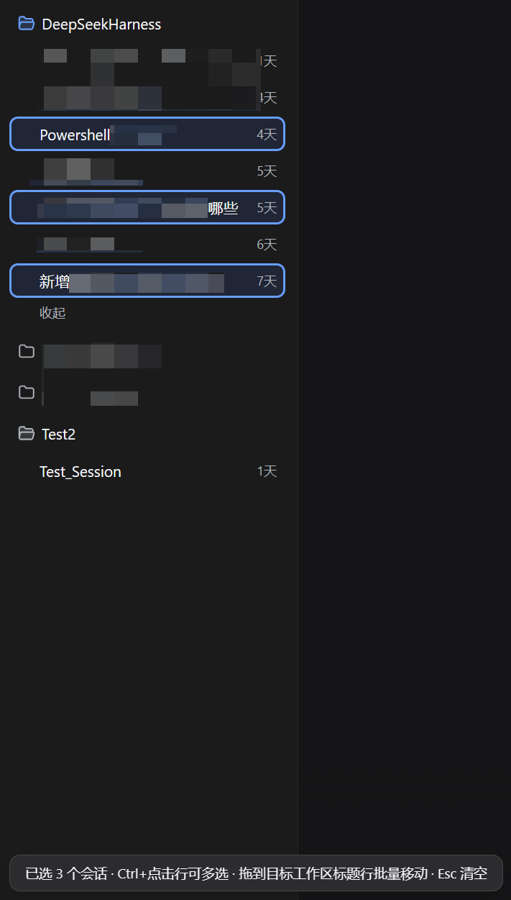
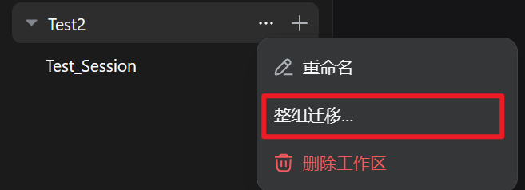
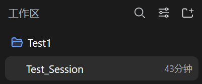
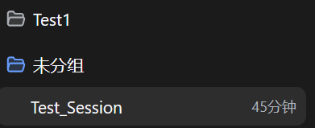
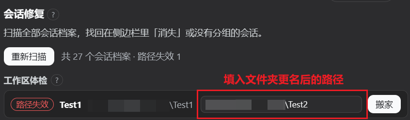
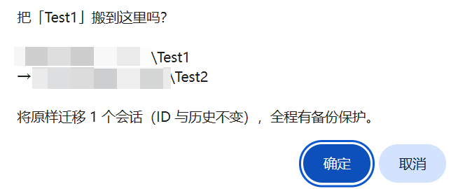
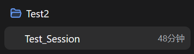

# dsh-workspace-mover


Current version: 2.4.1. In v2.4.0, running or resident sessions wait in the durable queue. Idle alone does not release a backend writer; unload the session or restart DSH before migration. Migration sets the current working directory to the target workspace, preserving existing directory-change events and appending a final change when needed. See the [Desktop acceptance record](docs/compatibility/issue-5-desktop-acceptance-2026-10-22.md) and [validation record](docs/compatibility/dsh-0.2.1-rc.2-2026-10-18.md).
> [!IMPORTANT]
> Unofficial project, independently developed and maintained by community members.

<!-- Hero -->
<div align="center">
  <b style="font-size: 1.15em;">Drag a session onto another workspace in the sidebar—a true move of the original archive, not a copy</b><br /><br />

  <p style="font-size: 0; line-height: 1;">
    <a href="https://github.com/PianoPrince/dsh-workspace-mover/actions/workflows/test.yml"></a>
    <a href="https://www.npmjs.com/package/dsh-workspace-mover"></a>
    <a href="https://www.npmjs.com/package/dsh-workspace-mover"></a>
    
    
    
  </p>
  <p style="font-size: 0; line-height: 1;">
    <a href="https://github.com/PianoPrince/dsh-workspace-mover/stargazers"></a>
    <a href="./LICENSE"></a>
    <a href="https://awesome-dsh-plugin.com"></a>
    <a href="https://www.dsh.so/artifact/dsh-workspace-mover/"></a>
    
    
    
  </p>
  <p style="font-size: 0; line-height: 1;">
    
    <!-- release-downloads-badge:start --><!-- release-downloads-badge:end -->
  </p>
</div>

<div align="center">
  🌏 <a href="./README.md"><b>中文</b></a> · English
</div>

## 📑 Table of Contents

- [✨ Features](#-features)
- [🚀 Install](#-install)
- [🖼️ Tour](#️-tour)
- [⌨️ Usage](#️-usage)
- [🔌 How it integrates with DSH](#-how-it-integrates-with-dsh)
- [🤝 Coexistence with other plugins](#-coexistence-with-other-plugins)
- [🧩 Compatibility and uninstall](#-compatibility-and-uninstall)
- [🔐 Safety Ledger](#-safety-ledger-安全台账)
- [⚠️ Known limitations](#️-known-limitations)
- [🆕 Recent version](#-recent-version)

---

## ✨ Features

DeepSeek Harness's sidebar supports drag-to-reorder **within** a workspace, but dropping a session onto **another workspace** is silently ignored. This plugin adds cross-workspace migration:

- **🖱️ Drag-and-drop move**: drag an idle session row onto a target workspace title row and confirm
- **📦 Bulk move / group merge**: multi-select with Ctrl/Shift and drag the set, or use a workspace header's "⋯" → "Move whole group…"; an emptied source group can be deleted in one confirmation (up to 50 per batch, failures isolated)
- **🚚 True move · zero tokens**: session id and full history are preserved as-is — no duplicates, no context re-injection
- **🏠 Move-home wizard**: after a project folder was moved or renamed, re-point the broken workspace in place; id, title, order, and archive flags stay, and member sessions plus strays migrate together
- **🛟 Session rescue** (Settings → Session Rescue): recover lost / unregistered / misfiled sessions; restore archived sessions; one-click repair and filtering
- **🗑️ Recycle bin and backups**: deletes go to the recycle bin first and can be restored; migrations create recovery snapshots that can be restored or cleaned up
- **🛡️ Data protection**: identical session content keeps one physical snapshot, so back-and-forth moves do not grow storage without bound; every move still appears in history with snapshot counts and footprint visible
- **⏪ Move history and undo**: last 100 cross-workspace moves; bulk operations aggregate into one undoable entry
- **🧾 Task center**: bulk moves persist per-item state (done/failed, last error and attempt time); failed items retry in one click — from each session's CURRENT location, never a stale path
- **⏳ Busy-session queue**: running sessions are never touched; queued work is persistent, with per-item cancel/retry and batch retry for failed items
- **🔎 Migration preview**: before confirmation, show source, target path, collisions, running state, adapter mode, and estimated new backup bytes; reuse is called out when a matching snapshot already exists
- **📂 Empty-group cleanup / open folder**: only truly empty workspaces are listed; open a group directory in your file manager
- **🤖 Agent tools**: six model-callable tools — `mover_list_sessions` / `mover_move_session` / `mover_repair_sessions` / `mover_doctor` / `mover_create_workspace` / `mover_rename_workspace` — so "move this session to group X" in the conversation runs the same backup-first pipeline as the panel, and workspaces can be created and renamed too; move, repair and rename ask for user approval first (rename skips it under full access), and hosts without `dsh-tools` skip them automatically

## 🚀 Install

```bash
dsh plugin --profile web add "github:PianoPrince/dsh-workspace-mover"
# Restart dsh web once
```

> **Zero-build install**: pure JavaScript source-as-product (no TypeScript, no build step). Installing from GitHub does **not** require `allowBuilds`.

<details>
<summary><b>npm channel</b></summary>

```bash
dsh plugin --profile web add dsh-workspace-mover
```

</details>

<details>
<summary><b>Local development install</b></summary>

```bash
dsh plugin --profile web add "link:C:/path/to/dsh-workspace-mover"
```

</details>

<details>
<summary><b>Desktop app install (DSH v0.2 desktop client)</b></summary>

1. Install and open the official desktop app, go to the 「插件」/ Plugins page in the left menu;
2. Click "Add plugin" and search for `dsh-workspace-mover`, then install and enable it;
3. Done — the desktop profile is independent from the web profile, so install once per profile.

> The desktop profile is managed exclusively by the Electron application (the standalone CLI rejects `--profile desktop`); use the in-app plugin page.

</details>

<details>
<summary><b>Troubleshooting</b></summary>

| Symptom | What to do |
|---|---|
| Drag does nothing | Use **grouped view** and drop on a **workspace title row**; flat list view has no title rows and stays inactive |
| Session is running | Wait for the current turn to finish, then move |
| Move failed toast | There is a backup and automatic rollback; retry after following the toast. Details are in the host log under `MOVE FAILED` |
| Move succeeded but sidebar didn't regroup | Refresh the page |
| Some sessions vanished from the sidebar | Open **Settings → Session Rescue** to scan and recover them |
| After upgrading to DSH 0.2, switching models on old sessions fails with `Unknown agent preset` | 0.2 no longer reads the 0.1.x legacy custom-preset directory; presets must be migrated to declaration rows — unrelated to this plugin, full steps in [docs/dsh-0.2-preset-migration.md](docs/dsh-0.2-preset-migration.md) |

</details>

## 🖼️ Tour

> Real UI screenshots (click to enlarge).

### Drag across workspaces

| | |
|---|---|
| **Drag an idle session row onto a target workspace title row** | **Confirm dialog shows the destination path** |
|  |  |
| **Settings → Session Rescue** | |
|  | |

### Bulk move · multi-select

| |
|---|
| **Ctrl+click to multi-select (the open session is included automatically), count badge bottom-left; drag any selected row; Esc clears** |
|  |
| **Header "⋯" → "Move whole group…" for group merge** |
|  |

### Move-home wizard · walkthrough

A real rename: folder `Test1` → `Test2`, then repair the workspace in place.

| | |
|---|---|
| **Before rename** | **After rename (folder gone on disk)** |
|  |  |
| **Health panel marks the path invalid** | **Confirm old → new path and session count** |
|  |  |
| **Done: group renamed to Test2, history intact** | |
|  | |

## ⌨️ Usage

### Drag across workspaces

1. After restart, open **grouped view** in the sidebar and hold an idle session row;
2. Drop it on a target workspace title row;
3. Confirm the destination path → **Move**;
4. Toast confirms; refresh the page if the sidebar does not regroup automatically.

Mid-turn sessions are rejected; failed moves roll back automatically.

### Session rescue panel

1. **Settings → Session Rescue** scans on open;
2. **Lost / orphaned**: pick a target workspace → **Move**;
3. **Unregistered**: **Attach** in place to the matching workspace;
4. **Misfiled**: **Home** or **Home all**;
5. **One-click repair** runs fixable items with per-item isolation;
6. Filter by title / session id / path / group;
7. **Archived / recycle bin / backups**: restore archived sessions; restore or purge deleted sessions; restore or clean backups.

### Conversational moves (agent tools)

Operations requiring approval are refused when the approval service is absent; use the rescue panel in settings instead.

1. Hosts with `dsh-tools` (web and desktop by default) register six model tools: listing and doctor (both read-only), move, one-click repair, create workspace, and rename workspace;
2. Say "list my sessions", "move session X to group Y", "run a repair", "run a self-check", "create a workspace called Z for folder /path", or "rename group Y to Z" — the model resolves names into exact ids with the listing tool first, then acts;
3. Move and repair tools raise a host approval prompt before acting (same level as the panel confirm); dismissing or denying means nothing happens; the two read-only tools never prompt;
4. **Create workspace** registers an existing folder under a new name. It is refused if another workspace already uses that folder (including a symlink to it) or that name, and it never creates folders on disk. It does not ask for approval;
5. **Rename workspace** changes only the display name and asks for approval first. Sessions with **full access** (`danger-full-access`) rename without asking. A name another workspace already uses is refused;
6. Hosts without `dsh-tools` skip the tools automatically — the panel and drag flows are unaffected.

### Bulk move

1. **Ctrl/Cmd+click** to select, **Shift+click** for a range, **Esc** to clear;
2. Drag any selected row → **Move all**;
3. Or **"⋯" → "Move whole group…"**; delete an emptied source group to merge.

### Move-home wizard

1. After a folder move/rename, health check marks the group **path invalid**;
2. Enter the folder's current full path → **Move**;
3. Confirm paths and session count; running sessions skip — rerun to finish the rest.

## 🔌 How it integrates with DSH

For users, the integration contract is:

1. Mounted through **official DSH extension points** — DSH and dsh-market install files are not modified;
2. Workspace membership changes use the host's **official interfaces** — no forged persistence data;
3. Plugin-owned data (history, backups, recycle bin) lives in a **separate data directory**, apart from session archives;
4. Official same-group sidebar sorting is **left alone** — only cross-workspace drops are handled.

Implementation details: [docs/ARCHITECTURE.md](docs/ARCHITECTURE.md).

## 🤝 Coexistence with other plugins

Built to coexist: private communication/style namespaces, no rewrites of official install files, official interfaces for membership writes.

| Plugin category | Compatibility | Notes |
| --- | --- | --- |
| Official built-in plugins (the eight shipped since 0.2: terminal / web search / subagents / …) | ✅ No conflict | Disjoint feature surfaces; agent tools coexist through the official `dsh-tools` registry — this plugin's tools are namespaced with a `mover_` prefix |
| Sidebar enhancements / better-sidebar / terminals / cost meters / memory / export & share | ✅ No conflict | Different panels and data surfaces |
| Archive managers | ✅ Compatible | Both use official archive data; panel features may overlap |
| Recycle-bin / session-delete plugins | ✅ Isolated data | Each plugin keeps its own recycle-bin directory, none shared; enable one delete entry point to avoid confusion |
| Sort / pin plugins | ⚠️ Mostly compatible | Moves re-sort "Recently updated" precisely; display order in other plugins may differ slightly |
| Plugins that redraw the sidebar | ⚠️ Graceful degradation | If the official sidebar structure is replaced, features may stop triggering — **no data damage** |
| Other session movers | ❌ Pick one | Two drag interceptors can double-handle one drag; this plugin covers move / bulk / merge / homing / archive restore |

## 🧩 Compatibility and uninstall

### Why does the storage adapter show a warning?

DSH currently exposes no public raw archive path or raw-byte relocation API. The plugin uses the host storage root and checked JSONL layout, reported as `filesystem-fallback`. This is a compatibility warning; check the storage-layout result as well. Run doctor again after host upgrades and stop migration if the layout is unknown or damaged. Handle-only providers without physical paths cannot relocate archives.

Recovery snapshots are separate from primary archives. A reused snapshot retains its original saved path; restoration uses that path unless another workspace is selected. History does not guarantee indefinite snapshot retention: policy limits or manual cleanup can remove a referenced snapshot.

### Version compatibility matrix

| Plugin version | Verified DeepSeek Harness | Node | Notes |
|----------------|---------------------------|------|-------|
| 2.4.0 | `0.2.1-rc.2` Desktop | `≥22` | User accepted queueing, continued replies, two restarts, target cwd and workspace-tool approval; autoscroll automated checks only |
| 2.3.0 | `0.2.0-rc.2` Desktop (partial user verification) | `≥22` | Idle migration and snapshot reuse confirmed; Web, queue process restart, and full runtime smoke pending |
| 2.2.0 | `0.1.5-rc.1`, `0.1.5-rc.2`, **`0.2.0 desktop`** (0.2.0-rc.2 core) | `≥22` | Storage-layout check; Agent tools + desktop verified; tools auto-skip on hosts without `dsh-tools` |
| 2.0.3 | `0.1.5-rc.1`, `0.1.5-rc.2` | `≥22` | True move / bulk / rescue / recycle bin / backups; first npm publish |
| — | `0.2.0 web` (0.2.0-rc.2) | `≥22` | Same core as the desktop build, adapted on the same code paths; web boot regression pending |

### Session archive format validation

“Local pass” below means repository sandbox fixtures, not an official DSH runtime test for each archive format. The v2.4.0 Desktop 0.2.1-rc.2 acceptance passed for queueing, restart migration, continued replies and workspace-tool approvals; the per-format Official DSH runtime cells below remain pending. Autoscroll has automated DOM coverage only; manual acceptance was waived. See the [Desktop acceptance record](docs/compatibility/issue-5-desktop-acceptance-2026-10-22.md) and [format compatibility report](docs/compatibility/dsh-0.2.0-rc.2-2026-10-13.md).

| Archive layout | Local sandbox | Official DSH runtime |
| --- | --- | --- |
| v3 / v4 Zstd | Move and undo pass; highest generation selected while older files are preserved | Pending |
| Legacy / v3 plain JSONL | Move and undo pass without upgrading the generation | Pending |
| Mixed compression encodings | Explicitly rejected | Pending |
| Filename/header generation mismatch | Rejected before move when the header declares a generation; bytes remain unchanged | Pending |

- **Engines**: `package.json` → `engines.dsh` ≥ `0.1.5-rc.1`, `engines.node` ≥ `22` (aligned with the CI Node 22/24 matrix).
- **Other known combination**: dsh-market `1.45.1`. Does not patch DSH source; official extension points only.
- **Quality gate**: run `npm run check` before opening a PR (syntax + tests + `npm pack --dry-run`); CI runs the same steps on ubuntu / windows / macos × Node 22/24.
- **Marketplace "host requirement unknown"**: GitHub-only packages without an npm manifest may show unknown — that is metadata, not runtime incompatibility.
- **DSH 0.2 preset migration**: 0.2 no longer reads the 0.1.x legacy custom-preset directory (`$DSH_HOME\.agent-presets\`); resuming old sessions fails with `Unknown agent preset` (a host change, unrelated to this plugin). Migration steps and a real-world record: [docs/dsh-0.2-preset-migration.md](docs/dsh-0.2-preset-migration.md).
- **Uninstall is reversible**: removing the plugin does not delete session archives, workspaces, or official bookkeeping. Plugin history/tasks/backups/recycle-bin data stay in the plugin data directory (see [docs/ARCHITECTURE.md](docs/ARCHITECTURE.md)); refresh or restart DSH to clear injected UI.
- **Coexistence**: do not enable a second cross-workspace drag mover; other categories can follow the table above.
- **Storage fallback is visible**: `mover.status` reports `filesystem-fallback`, `official-handle`, or `unavailable`. Handle-only providers remain diagnostic/preview capable, while physical moves fail explicitly with `unsupported` instead of guessing a path.

Some advanced actions need newer DSH capabilities; when unavailable the UI says so instead of failing silently.

## 🔐 Safety Ledger (安全台账)

Every migration runs through the same safety-bounded pipeline: **byte-level backup first → stepwise rollback → post-move verification → recovery ledger as the last resort**. Any failure returns to the pre-move state; the extreme case where even the rollback fails writes a durable recovery record and raises a red row in the rescue panel for manual review — data never disappears.

**Never-does:**

- Never performs any git write operations (no commit / stash / reset / checkout);
- Never touches a file before the byte-level backup is on disk;
- Never silently discards session data — unrecoverable extremes are flagged in red with the scene preserved;
- Never runs a destructive action without confirmation (conversational move / repair additionally requires the host approval prompt);
- Never uploads any local data — the plugin makes no network requests, everything runs locally.

**Concrete guarantees:**

- **Automatic recovery snapshot before every move**; identical content (ignoring migration-only `cwd` changes) reuses an existing snapshot, then the landed session identity and path are re-checked — mismatch rolls the whole move back;
- **Every move remains in history** with source, target, and the snapshot used, so deduplication never hides the operation trail;
- **On failure, restore to the pre-move state** (files and bookkeeping together);
- **Deletes go to the recycle bin first** and can be restored to the original spot or any group; permanent delete needs a second confirmation;
- **If automatic recovery is not possible**, the rescue panel flags it for manual review; session files and backups are kept;
- **Recently opened sessions still resident in Harness memory** cannot be deleted until you restart Harness (the UI says so clearly).

> Failure paths prefer keeping your data — sessions are never silently dropped.<br>
> This is **not** a claim that every error auto-recovers: extreme cases need manual action, with data left in place.

## ⚠️ Known limitations

- Moving into the "Ungrouped" bucket is not supported;
- Sessions still resident in Harness memory (opened recently) cannot be deleted until you restart Harness;
- If a third-party plugin fully redraws the sidebar, features may stop triggering (**no data damage**);
- Flat list view has no workspace title rows — the plugin stays inactive there;
- Major host upgrades that change internal structures may degrade some actions or require a restart; the move-home wizard aborts before touching files if it cannot write safely.

## 🆕 Recent version

### v2.4.0 · 2026-10-22

- **Issue #5 safe migration**: running or resident sessions enter a durable queue; migration waits for unload or restart and writer release, preserving working-directory history.
- **Workspace tools**: `mover_create_workspace` registers an existing folder; `mover_rename_workspace` changes only its display name and follows host approval rules.
- **Failure handling and UI cleanup**: a missing storage root is treated as an empty list while permission and I/O errors remain visible; sidebar autoscroll stops when the pointer leaves the sidebar or reaches a scroll boundary, on drag end/cancel, and on unload.
- **Acceptance**: DSH Desktop `0.2.1-rc.2` passed queueing, continued replies, two restarts, destination working directory and workspace-tool approval checks. Autoscroll received automated DOM checks only; manual acceptance was waived. See the [Desktop acceptance record](docs/compatibility/issue-5-desktop-acceptance-2026-10-22.md) and [CHANGELOG](CHANGELOG.md).

### v2.3.0 · 2026-10-13

- **Reusable recovery snapshots**: identical content reuses an existing snapshot, ignoring migration-only `cwd` changes. Changed content creates a new backup. Every move retains its source, target, and snapshot reference in history; up to 20 physical snapshots are retained by default, with legacy backups supported.
- **Clearer preview**: shows actual source, target path, collisions, running state, and newly required backup bytes. Reuse is explicit. A workspace selector fixes incorrect return-move targets.
- **Busy-session queue**: running sessions remain untouched and wait in a persistent queue for idle. Cancel and individual/batch retry are available; real DSH process-restart recovery remains unverified.
- **Storage and format diagnostics**: reports adapter mode and degradation reasons. Sandbox coverage includes v3/v4 and plain/Zstd, unsupported formats, unknown layouts, and damaged data without forced upgrades.
- **Branch and portable-bundle APIs**: optional descendant selection, export, checksums, and dry-run import. Conflicts and known insufficient space block import. These features have sandbox coverage but remain unverified in a real runtime.
- **Recovery fixes**: default restoration selects the newest backup; bundle space estimates include attachments. Added the npm weekly downloads badge.

### v2.2.0 · 2026-10-09

- **Batch moves no longer *guess* a session's identity**: when the authoritative id channel is unavailable, the old fallback substituted the next id in order; unresolvable rows are now skipped and reported in the confirm dialog, and a move with nothing resolvable aborts without touching any file
- **Target-group resolution must prove itself**: it no longer falls back to DOM position when neither title nor path matches — the official sidebar hides groups whose folder is gone, and the positional fallback moved sessions into a neighbouring group
- **Client hot-reload no longer stacks instances**: all seven document listeners and the menu observer are released through the host effect channel, plus a duplicate-apply guard; re-loading used to stack a second copy (double confirm dialogs, duplicate requests)
- **Storage-layout self-check**: one real session's directory is reverse-derived and verified, surfacing in `mover.status` and the Doctor panel (`data-layout`) so "one day everything is unfindable" becomes a visible degraded state instead
- **Orphan backups are visible and cleanable**: a purged session left up to 20 migration backups on disk forever; orphans are now flagged with one-click cleanup, and "purge" offers to remove them too
- **Archived list explains truncation**: the scan parses only the newest 400 archives, so older archived sessions can be missing — the UI now says so
- **Tunable policies**: physical snapshot retention / history length / batch cap / repoint cap / scan cap / cleanup age accept environment overrides (`DSH_WORKSPACE_MOVER_*`)
- **Official APIs replace private coupling**: unarchive uses the official `registry.unarchiveSession` (with a fallback path); title sync uses official `entity.setTitle` and is decoupled from the path redirect; `record.sessionIds` reads are consolidated into one accessor
- **Accessibility and copy**: dialogs gain `aria-labelledby`, initial focus and a Tab trap; Esc respects "not while typing in the composer"; dead strings removed and two hard-coded English strings localized, with a zh/en key-parity warning
- **Ecosystem metadata**: `screenshots.json` lets the plugin control its storefront card; host-package `peerDependencies` are declared as `*` and optional (metadata only — the real floor is `engines.dsh`, and any runtime mismatch is reported through capability flags); long-standing tool-count and compatibility drift in the READMEs/ARCHITECTURE is corrected
- **Fixed**: those peer ranges were first written in the ecosystem's "explicit prerelease branch" idiom, which made the host declare this plugin **incompatible with `0.2.0-rc.2`** — an upper bound of `<0.2.0-0` excludes *every* 0.2.0 prerelease, because npm evaluates each `||` alternative as a set and `0.2.0-rc.2 > 0.2.0-0`. All eight are now `*`, with a regression test spanning 0.1.5-rc.1 through 1.0.0
- Tests 108 → 144 (10 client DOM cases, 13 policy/Config/peer-range cases, plus host-side capability-flag, self-check and backup-GC coverage)

### v2.1.1 · 2026-10-05

- `mover.doctor` self-check: a "Doctor" button in the rescue panel plus a `mover_doctor` agent tool — ~13 checks over host services, data directories, recovery records and workspace paths, reported as pass/warn/fail; run it after a DSH upgrade before attempting anything else
- Trust assets: the npm one-liner featured under the tagline (the `dsh://` deep-link button was removed — GitHub strips custom-protocol links), dsh.so risk badge (listed, L5 run-tested / risk low), dsh-plugin-registry badge, "DSH tested 0.2.0-rc.2" badge
- Compatibility report: `docs/compatibility/` records the desktop verification; every future DSH adaptation adds a dated copy
- Security section rebranded as **Safety Ledger** with an explicit never-does list

### v2.1.0 · 2026-10-04

- Agent tools: `mover_list_sessions` (read-only listing) / `mover_move_session` / `mover_repair_sessions` register into the official `dsh-tools` registry and become callable from the conversation
- Mutating tools ask through the host approval seam before acting: denial, dismissal, or no answerer means nothing happens (fail-closed)
- They share the panel's locked, backup-first, post-move-verified pipeline; hosts without `dsh-tools` skip registration
- Desktop (0.2) verified in real use: fixed the post-hot-reload "inactive context" move error, and the confirm dialog is now opaque instead of blending with the text underneath
- `mover.status` gains an `agentTools` capability flag

### v2.0.3 · 2026-09-21

- First publish to npm: `dsh plugin --profile web add dsh-workspace-mover`
- Local quality gate `npm run check`; CI mirrors the same steps
- README npm / DSH badges and host compatibility matrix

Full history: [CHANGELOG.md](CHANGELOG.md).<br>
Architecture: [docs/ARCHITECTURE.md](docs/ARCHITECTURE.md).

## License

MIT

